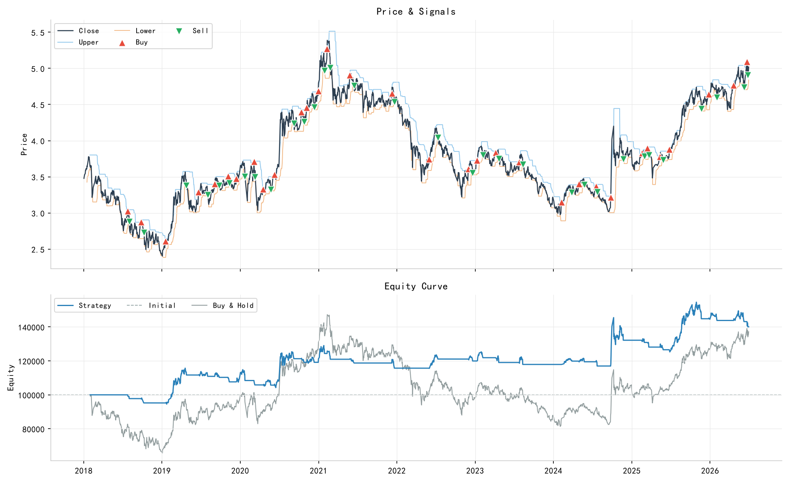
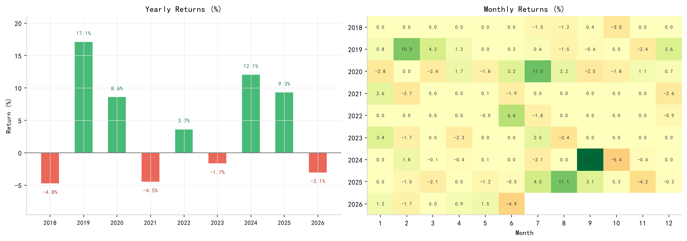
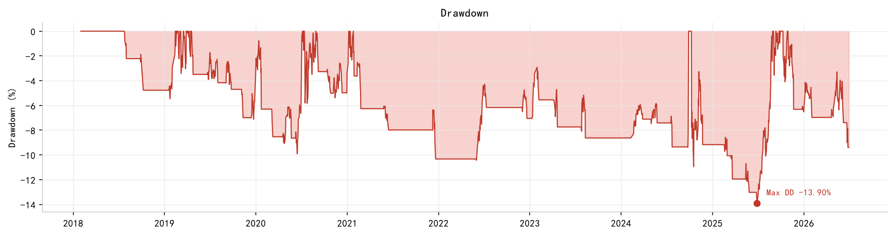
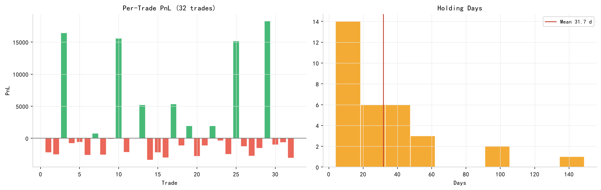

# Turtle Trading Strategy Backtest Framework

A modular, config-driven backtest framework for the classic Turtle trading strategy, written in Python.


## Overview

This is a lightweight, reusable template for trend-following strategies based on the classic Turtle rules. All parameters live in `config.yaml` — change the config, not the code.

## Screenshots

| Main Chart | Performance Analytics |
|------------|-----------------------|
|  |  |

| Drawdown | Trade Details |
|----------|---------------|
|  |  |

## Sample Performance (CSI 300 ETF, 2018–2026)

Backtest on **CSI 300 ETF** (2018-01 to 2026-04), using the classic turtle breakout logic with parameters `entry=20, exit=10, ATR period=10, ATR multiple=2.0`.

| Metric          | Value    |
|-----------------|----------|
| Total Return    | 40.08%   |
| Annual Return   | 4.09%    |
| Max Drawdown    | -13.90%  |
| Sharpe Ratio    | 0.46     |
| Calmar Ratio    | 0.29     |
| Total Trades    | 32       |
| Win Rate        | 31.2%    |
| Profit Factor   | 1.98     |
| Avg Hold (Days) | 31.7     |

### Key Observations
- **Low win rate, high profit factor** (31.2% vs 1.98): The classic signature of a trend-following strategy — many small losses, a few large wins.
- **Defensive characteristics**: Max drawdown is capped at **-13.90%** with a 2.0 ATR trailing stop, significantly lower than the underlying index's drawdown over the same period.
- **Long-only**: Designed for markets with short-selling constraints (e.g., A-shares).

## Features

- **Config-driven**: No code change needed to tune parameters.
- **Classic Turtle logic**: N-day breakout entry, M-day low exit.
- **ATR-based trailing stop**: Initial stop at `entry - 2.0 * ATR`, dynamically raised by the M-day low.
- **ATR position sizing**: Risk a fixed 2% of current equity per trade.
- **No look-ahead bias**: All signals are calculated using `.shift(1)`, ensuring execution at the earliest on the next bar.
- **Realistic friction**: Includes commission and slippage.
- **Professional charts**: Price & signals, equity curve, drawdown, yearly returns, and monthly heatmap.

## Quick Start

### 1. Install Dependencies

Requires Python 3.10+.

```bash
pip install -r requirements.txt